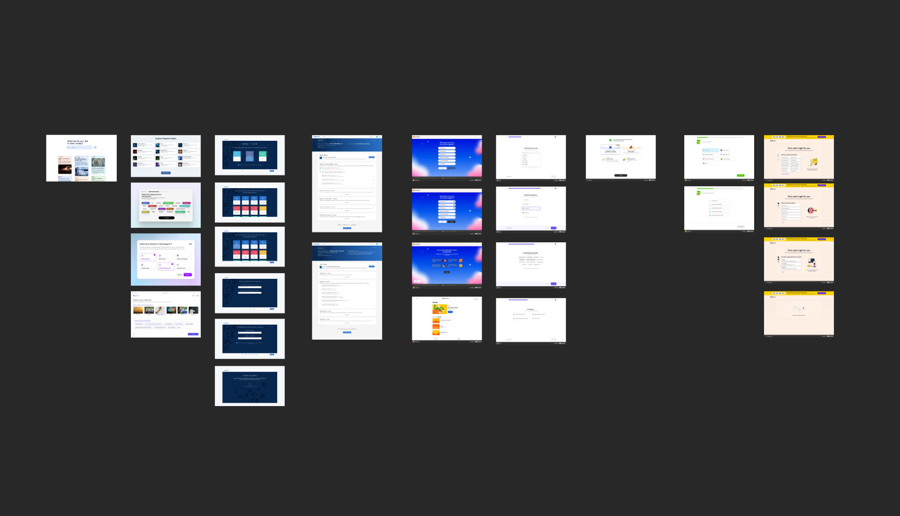
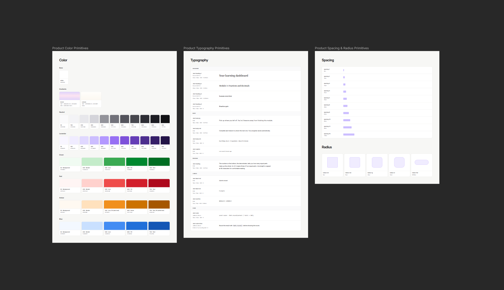
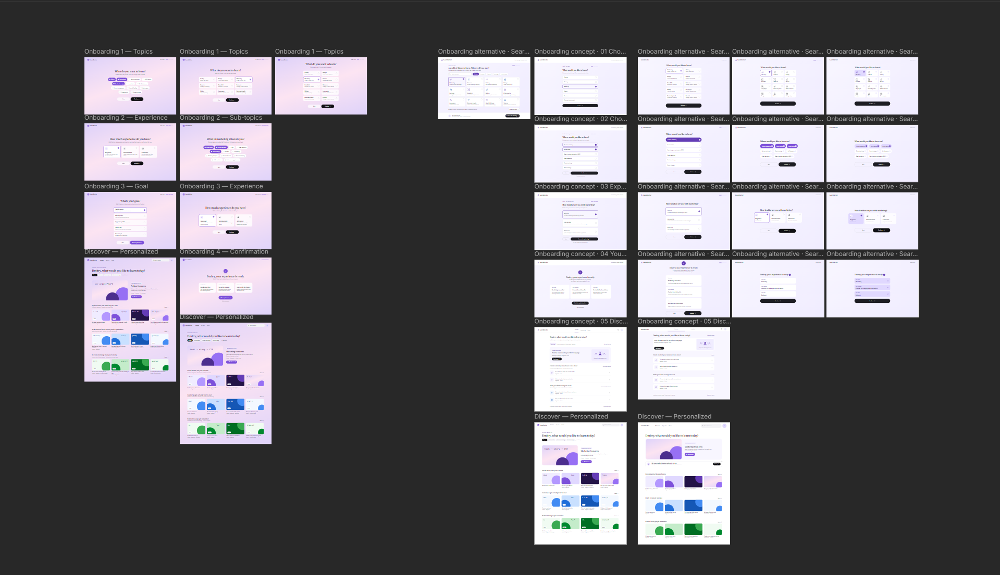

# LearnVector · A discovery page that gets to know you

**Prototype:** [onboarding.deeepatel.com](https://onboarding.deeepatel.com) · **Code:** [github.com/deepp2905/onboarding](https://github.com/deepp2905/onboarding)

Three quick questions, then straight into a Discover page shaped by the answers, which keeps learning from what you do on it. The goal: every screen after sign-in should feel like it already knows a little about you, without making you work for it.

## How I approached it

**Exploration first, on canvas.** I started in Paper, using the Mobbin MCP to pull onboarding flows from education and learning products: **Headspace**, **Duolingo**, **Uxcel** and **Codecademy**.

- **Duolingo, Codecademy:** pick a subject → narrow it → self-rate your level. A familiar three-beat rhythm learners already trust.
- **Headspace:** one calm question per screen, generous whitespace, nothing competing with the choice.
- **Uxcel:** a summary to review before committing, and a home screen that immediately reflects your answers.


*Research board in Paper: onboarding flows from education and learning apps, pulled in with the Mobbin MCP.*

**Primitives before screens.** Before designing any screen, I set up the product's color, typography, spacing and radius primitives in Paper, with a lavender brand scale in LearnVector's style. Every screen and component is built from these, and they map one-to-one to `src/ds/tokens.css`.


*Design primitives in Paper: color (neutral, lavender and status scales), typography and spacing/radius.*

**Iterate on canvas until it's opinionated.** I mocked up flows with AI, then reworked them by hand. Early versions had a separate goal step and asked for sub-topics and experience in a different order. Alternatives tried a search-led topic picker and list, chip and card layouts for each question. I explored several Discover layouts before settling on three questions, a summary and one Discover page.


*Design iterations in Paper: early flows (left), alternative concepts for each question (right), and Discover layouts.*

**Why not a chatbot.** My first idea was a conversational agent that interviews you. I dropped it for onboarding: it's heavy for gathering three facts, it makes you type (slow on a phone at lunch, like Priya), and it's harder to scan, undo or change. A chat agent earns its place later, when it actually *builds* the personalized path. That's where the **Build a path** card on Discover leads.

**Nine topics, on purpose.** The brief starts with marketing, but the topic gallery offers nine, each with its own sub-topics, levels and lessons. A first question with one real answer isn't a question, and it proves the flow adapts to any catalog.

## UX decisions

- **Ask little, then get out of the way.** Three questions: what you want to learn, what to focus on, how familiar you are. Then the product. Everything else is learned from use.
- **Seamless, personal questions.** One persistent shell: the header, background and buttons never reload, only the question changes. Each question builds on your last answer ("What part of *marketing* do you want to focus on?"), and the focus chips change with the topic you picked.
- **The learner stays in control.** Back on every question. A summary where each answer has its own Edit. Switching topic clears focus picks that no longer apply. Promos are dismissible. The wordmark starts over.
- **Every lesson card has a ⋮ menu.** Save for later, Add to my path, Show more like this, Share, Copy link, and Hide. Hiding asks a light, closable **"Why hide this?"**: *Too advanced · Not relevant to me · I already know this*. That's how the page gets more personal *without asking up front*: the learner volunteers a signal at the moment it matters to them.
- **Explain why, always.** Recommendations say who they were picked for ("Picked for beginners"), and the path card repeats your own picks back to you ("Built around content & social media, starting from the basics").

## Content logic: what shows, when (UX copy)

| Where | What it shows | Driven by |
|---|---|---|
| Greeting | "Dmitry, here's where to start with marketing." | Topic |
| Featured lesson | A different lead lesson for beginner, intermediate and advanced | Level |
| Recommended lessons for you | Your focus areas first, then lessons closest to your level | Focus + level |
| Quick 10 minute watches | Short lessons first, for a phone at lunch | Lesson length |
| Themed row | A hand-picked collection ("Build a brand people remember") | Topic |
| Personalized path card | Your picks and level in plain words, dismissible | Focus + level |
| Search, no results | "Nothing for '…'" plus lessons popular with your level | Level |
| Card menu feedback | Toasts confirm each action; Hide thanks you and says what changes | Your actions |

Copy rules: second person, short sentences, the learner's own words reflected back, and no screen without a clear next action.

## Motion, and why it works

- **One flow, not four pages.** Steps slide in the direction you're travelling and reverse on Back. The panel springs to each step's height, so the buttons glide instead of jumping.
- **Motion that explains.** The selection highlight slides between options, checkmarks draw themselves, and Back grows in to share the row with Continue.
- **Refined, pass by pass.** One shared press feel (0.97 scale, same spring) everywhere. Indicators grow from half scale instead of zero, so they feel less theatrical. Hover motion is shorter and limited to mouse and trackpad, so taps never stick. Discover enters in one ranked order instead of all at once. Popovers scale from the corner they're anchored to. Ambient orbs are softened with their gradients instead of a heavy blur, to protect frame rate.
- **Respectful.** With `prefers-reduced-motion`, movement becomes fades and the panel height snaps.

## Phone and desktop

On a phone, the Continue row is pinned within thumb reach, level cards stack as rows, lesson menus flip above the card when there's no room below, and the nav collapses into an overlay menu whose items stagger in like the onboarding options. On desktop, content gets room at a comfortable reading width.

## How I used AI tools

1. **Research** references on Mobbin (MCP), and think through design decisions and the user flow with Claude.
2. **Decide the content**: what to ask, and what to show and when.
3. **Build design system primitives** (color, type, spacing) in Paper.
4. **Mock up with AI**, then **iterate by hand on the canvas** until the design was opinionated and right.
5. **Code it out** from the Paper designs with the Paper MCP and Claude Code.
6. **Audit with skills** for animation and accessibility issues, then clean up the interactions and polish.

## With more time I would

- **Make feedback real.** Hide, Show more like this and Save should re-rank the rows, not just confirm.
- **Edit without the detour.** Edit on the summary sends you back to that question, and you click Continue forward again. It should return you straight to the summary.
- **Edit preferences after onboarding.** Change topic, focus or level from Discover without starting over.
- **Real thumbnails** in place of the abstract lavender art.
- **Ask about work, lightly.** The guide needs your *work* as well as your goal (Cathy's bank context). One optional nudge after the first lesson, not a fourth step.
- **Remember the learner.** Persist answers and saves across sessions; a refresh currently starts over.
- **More craft and product thinking.** Keep refining interactions and motion, and work out how to get someone from sign-in to a *finished first lesson* as fast as possible.

---

## Appendix: running it

```bash
npm install
npm run dev        # http://localhost:5173
npm run build      # type-check + production build
```

Built with React, TypeScript, [Motion](https://motion.dev) and plain CSS. Design tokens from Paper live in `src/ds/tokens.css`.

```
src/
  ds/            tokens, typography, shared components, motion presets
  onboarding/    flow shell + one component per step, topic data
  discover/      Discover page, lesson menu, content and ranking (buildRows)
```

**Accessibility:** real buttons with `radio` / `checkbox` / `menuitem` roles, arrow-key menus, visible focus rings, a polite live region on step changes, 44px hit targets, Escape closes menus and returns focus, and reduced-motion support throughout.
